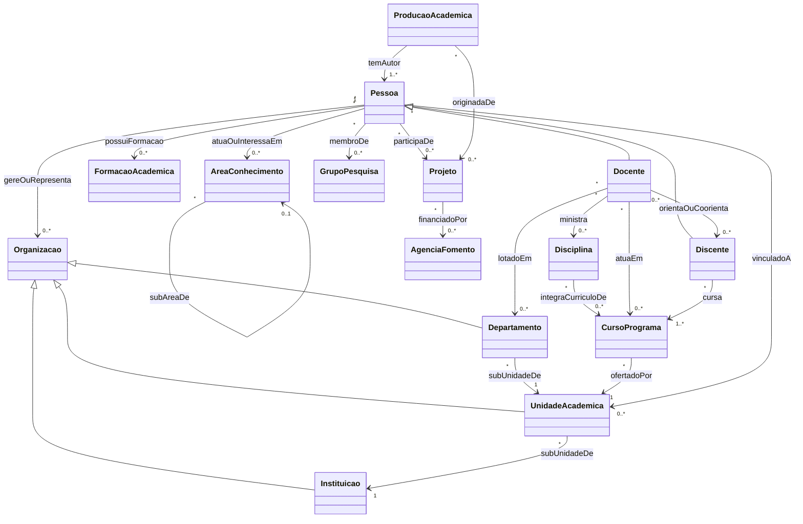
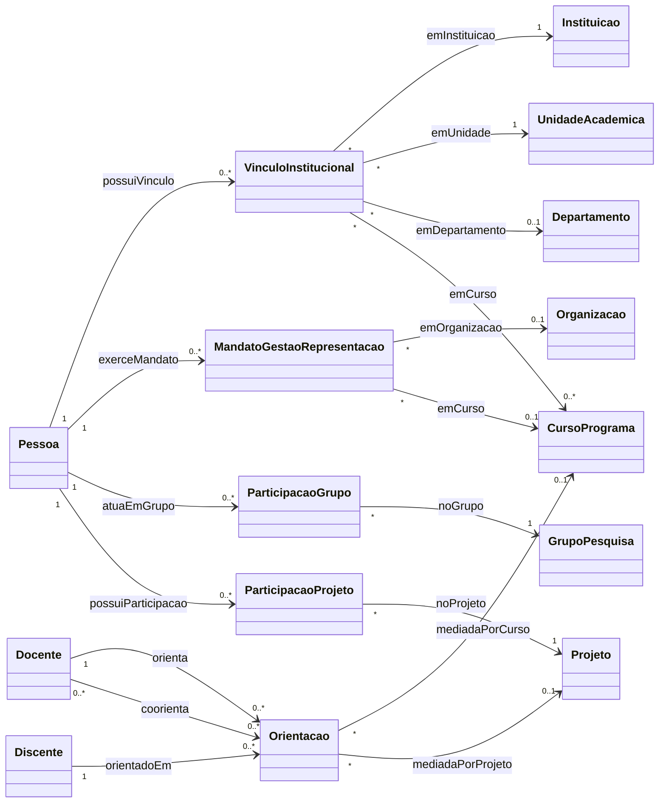

# Modelo Conceitual — Comunidade Acadêmica Universitária

## 1. Objetivo e Escopo

Este documento descreve o **modelo conceitual de domínio** da comunidade acadêmica universitária, contemplando docentes, discentes, estrutura organizacional, atividades de ensino, pesquisa, extensão, gestão e representação colegiada, orientações e produção científica.

Dentro do universo mais amplo da comunidade universitária — cuja taxonomia terminológica em `vocabulario_controlado_ufrrj.md` mapeia também servidores técnico-administrativos e colaboradores terceirizados ou externos para completude institucional —, o escopo deste modelo de perfis acadêmicos focaliza **docentes**, **discentes** e **coautores/colaboradores científicos** (representados pela superclasse concreta `Pessoa`), atendendo diretamente às demandas do sistema.

O modelo representa exclusivamente as entidades, atributos intrínsecos, relacionamentos e regras da **realidade do domínio**, abstendo-se de aspectos de interface, apresentação visual ou implementação tecnológica.

---

## 2. Diagramas Conceituais do Domínio

A modelagem visual está organizada em dois diagramas complementares: uma visão geral de alto nível com as entidades nucleares do domínio (usando relações diretas simplificadas/derivadas para facilitar a leitura) e um detalhamento das entidades associativas que qualificam vínculos, mandatos, participações e orientações.

### 2.1 Visão Geral de Alto Nível

### 2.2 Entidades Associativas (Qualificação de Relações)

---

## 3. Entidades e Atributos

### 3.1 Pessoas

#### `Pessoa` *(superclasse)*
Representa qualquer indivíduo da comunidade acadêmica (docentes e discentes) ou coautor/colaborador científico externo vinculado a produções acadêmicas, podendo ser instanciada diretamente quando não houver vínculo docente ou discente na instituição.

| Atributo | Tipo Conceitual | Obrigatório | Mult. | Descrição |
| :--- | :--- | :---: | :---: | :--- |
| `nomeCompleto` | Texto | Sim | 1 | Nome completo do indivíduo. |
| `nomeSocial` | Texto | Não | 0..1 | Nome pelo qual o indivíduo opta por ser socialmente reconhecido na comunidade acadêmica. |
| `nomesCitacao` | Texto | Não | 0..* | Formas padronizadas de citação bibliográfica. |
| `biografia` | Texto | Não | 0..1 | Síntese da trajetória acadêmica e de atuação. |
| `emailInstitucional` | Email | Não | 0..1 | Endereço de correio eletrônico institucional. |
| `emailAlternativo` | Email | Não | 0..1 | Endereço de correio eletrônico complementar. |
| `telefoneInstitucional` | Texto | Não | 0..1 | Telefone ou ramal institucional. |
| `localizacaoFisica` | Texto | Não | 0..1 | Localização de atendimento institucional (campus, prédio/pavilhão e sala). |
| `paginaPessoal` | URI | Não | 0..1 | Endereço da página web pessoal ou acadêmica do indivíduo. |
| `curriculoLattes` | URI | Não | 0..1 | Endereço do currículo na Plataforma Lattes (CNPq). |
| `orcid` | Identificador | Não | 0..1 | Identificador persistente internacional de pesquisador (*ORCID*). |
| `perfisExternos` | URI | Não | 0..* | Endereços de perfis em bases bibliométricas e redes acadêmicas ou profissionais (ex.: *Google Scholar*, *Scopus*, *Web of Science*, *ResearchGate*, *LinkedIn*, *GitHub*). |
| `papeisAcademicos` | Termo Controlado | Não | 0..* | Papéis de atuação acadêmica e científica exercidos na comunidade universitária que não estejam qualificados em uma entidade associativa específica (ex.: *Monitor Acadêmico*, *Bolsista de Iniciação Científica*, *Extensionista*). Papéis vinculados a grupos, projetos, orientações e cargos de gestão/representação são qualificados em `ParticipacaoGrupo`, `ParticipacaoProjeto`, `Orientacao` e `MandatoGestaoRepresentacao`. |

#### `Docente` *(especialização de `Pessoa`)*
Professor vinculado à instituição que atua em ensino, pesquisa, extensão e orientação. Herda os atributos de `Pessoa`.

#### `Discente` *(especialização de `Pessoa`)*
Estudante vinculado a um curso de graduação ou pós-graduação da instituição. Herda os atributos de `Pessoa` e acrescenta:

| Atributo | Tipo Conceitual | Obrigatório | Mult. | Descrição |
| :--- | :--- | :---: | :---: | :--- |
| `periodoAtual` | Texto | Não | 0..1 | Período ou semestre corrente no curso (ex.: `6º período`). |

---

### 3.2 Estrutura Organizacional

#### `Organizacao` *(superclasse)*
Representa entidades formais da estrutura universitária.

| Atributo | Tipo Conceitual | Obrigatório | Mult. | Descrição |
| :--- | :--- | :---: | :---: | :--- |
| `nome` | Texto | Sim | 1 | Nome oficial da organização ou unidade. |
| `sigla` | Texto | Não | 0..1 | Sigla institucional (ex.: `UFRRJ`, `ICE`, `DECOMP`). |

Especializações de `Organizacao`:
- **`Instituicao`**: a universidade.
- **`UnidadeAcademica`**: instituto ou centro acadêmico subordinado à instituição.
- **`Departamento`**: departamento acadêmico subordinado a uma unidade acadêmica.

#### `CursoPrograma`
Representa um curso de graduação ou programa de pós-graduação ofertado por uma unidade acadêmica.

| Atributo | Tipo Conceitual | Obrigatório | Mult. | Descrição |
| :--- | :--- | :---: | :---: | :--- |
| `nome` | Texto | Sim | 1 | Nome oficial do curso ou programa. |
| `grauModalidade` | Texto | Não | 0..1 | Grau acadêmico ou modalidade (ex.: *Bacharelado*, *Licenciatura*, *Mestrado*). |
| `codigoInstitucional` | Texto | Não | 0..1 | Código oficial do curso na instituição. |

---

### 3.3 Vínculos Institucionais, Gestão e Representação

#### `VinculoInstitucional`
Entidade associativa que qualifica a relação formal entre uma `Pessoa` e a estrutura universitária (`Instituicao`, `UnidadeAcademica`, `Departamento` e/ou `CursoPrograma`), permitindo registrar múltiplos vínculos ou histórico institucional.

| Atributo | Tipo Conceitual | Obrigatório | Mult. | Descrição |
| :--- | :--- | :---: | :---: | :--- |
| `identificadorInstitucional` | Texto | Não | 0..1 | Registro funcional ou matrícula institucional. |
| `tipoVinculo` | Termo Controlado | Sim | 1 | Natureza do vínculo segundo a Faceta 1 do vocabulário controlado institucional (ex.: *Docente Efetivo*, *Docente Não Efetivo*, *Discente de Bacharelado*, *Discente de Mestrado*). |
| `cargoClasse` | Termo Controlado | Não | 0..1 | Cargo, classe funcional, contrato docente ou nível de carreira segundo a Faceta 1 do vocabulário controlado institucional (ex.: *Professor Adjunto*, *Professor Associado*, *Professor Titular*, *Professor Substituto*, *Professor Visitante*). |
| `situacao` | Texto | Sim | 1 | Situação do vínculo (ex.: *Ativo*, *Afastado*, *Egresso*, *Aposentado*, *Desligado*). |
| `anoIngresso` | Ano | Não | 0..1 | Ano de início do vínculo institucional. |
| `anoFim` | Ano | Não | 0..1 | Ano de encerramento do vínculo institucional (ausente quando ativo). |

#### `MandatoGestaoRepresentacao`
Entidade associativa que representa cargos de gestão executiva ou acadêmica e mandatos de representação colegiada exercidos por uma `Pessoa` em um órgão, unidade organizacional (`Organizacao`) ou curso/programa (`CursoPrograma`), delimitados temporalmente.

| Atributo | Tipo Conceitual | Obrigatório | Mult. | Descrição |
| :--- | :--- | :---: | :---: | :--- |
| `cargo` | Termo Controlado | Sim | 1 | Cargo de gestão ou representação exercido segundo o vocabulário controlado institucional (ex.: *Chefe de Departamento Acadêmico*, *Coordenador de Programa de Pós-Graduação*, *Diretor de Unidade Acadêmica*, *Conselheiro de Colegiado Superior*, *Representante Discente*). |
| `anoInicio` | Ano | Sim | 1 | Ano de início do mandato ou exercício do cargo. |
| `anoFim` | Ano | Não | 0..1 | Ano de término do mandato (ausente quando em exercício). |

---

### 3.4 Ensino e Formação

#### `FormacaoAcademica`
Representa titulações acadêmicas concluídas ou em andamento.

| Atributo | Tipo Conceitual | Obrigatório | Mult. | Descrição |
| :--- | :--- | :---: | :---: | :--- |
| `nivel` | Texto | Sim | 1 | Nível da formação (ex.: *Ensino Médio*, *Graduação*, *Mestrado*, *Doutorado*). |
| `tituloObtido` | Texto | Sim | 1 | Denominação do título ou curso. |
| `instituicao` | Texto | Sim | 1 | Nome da instituição emissora do título (mantido como atributo textual para abranger instituições externas sem exigir sua modelagem na estrutura organizacional da universidade). |
| `anoIngresso` | Ano | Não | 0..1 | Ano de ingresso na formação. |
| `anoConclusao` | Ano | Não | 0..1 | Ano de conclusão (ausente quando em andamento). |

#### `Disciplina`
Representa um componente curricular ministrado por docentes.

| Atributo | Tipo Conceitual | Obrigatório | Mult. | Descrição |
| :--- | :--- | :---: | :---: | :--- |
| `codigo` | Texto | Não | 0..1 | Código institucional da disciplina. |
| `nome` | Texto | Sim | 1 | Nome da disciplina. |

---

### 3.5 Pesquisa, Extensão e Orientação

#### `AreaConhecimento`
Representa áreas de atuação, pesquisa ou interesse acadêmico, estruturadas hierarquicamente (`subAreaDe`) segundo classificações científicas (como a tabela do CNPq) e descritores temáticos.

| Atributo | Tipo Conceitual | Obrigatório | Mult. | Descrição |
| :--- | :--- | :---: | :---: | :--- |
| `nome` | Texto | Sim | 1 | Denominação da área ou tema de conhecimento. |
| `classificacaoCnpq` | Texto | Não | 0..1 | Hierarquia oficial na tabela de áreas do CNPq (Grande Área > Área > Subárea > Especialidade). |
| `tipoArea` | Texto | Não | 0..1 | Classificação entre área formal (*Área CNPq*) e descritor temático (*Palavra-chave / Interesse*). |

#### `GrupoPesquisa` e `ParticipacaoGrupo`
`GrupoPesquisa` representa um grupo de pesquisa institucional composto por docentes e discentes. `ParticipacaoGrupo` qualifica o papel específico e o período de atuação de cada integrante no grupo.

**Atributos de `GrupoPesquisa`:**

| Atributo | Tipo Conceitual | Obrigatório | Mult. | Descrição |
| :--- | :--- | :---: | :---: | :--- |
| `nome` | Texto | Sim | 1 | Nome oficial do grupo de pesquisa. |
| `descricao` | Texto | Não | 0..1 | Escopo e linhas de pesquisa do grupo. |

**Atributos de `ParticipacaoGrupo`:**

| Atributo | Tipo Conceitual | Obrigatório | Mult. | Descrição |
| :--- | :--- | :---: | :---: | :--- |
| `papelNoGrupo` | Termo Controlado | Sim | 1 | Função exercida pelo integrante no grupo segundo o vocabulário controlado institucional (ex.: *Líder de Grupo de Pesquisa*, *Pesquisador Associado*, *Bolsista de Iniciação Científica*). |
| `anoInicio` | Ano | Não | 0..1 | Ano de ingresso do integrante no grupo. |
| `anoFim` | Ano | Não | 0..1 | Ano de saída do integrante (ausente enquanto ativo). |

#### `Projeto` e `ParticipacaoProjeto`
`Projeto` representa uma iniciativa formal de pesquisa, extensão ou ensino. `ParticipacaoProjeto` qualifica o papel específico e o período de atuação de cada participante no projeto.

**Atributos de `Projeto`:**

| Atributo | Tipo Conceitual | Obrigatório | Mult. | Descrição |
| :--- | :--- | :---: | :---: | :--- |
| `titulo` | Texto | Sim | 1 | Título do projeto. |
| `tipoProjeto` | Texto | Sim | 1 | Natureza do projeto (ex.: *Pesquisa*, *Extensão*, *Ensino*). |
| `descricao` | Texto | Não | 0..1 | Resumo dos objetivos do projeto. |
| `anoInicio` | Ano | Não | 0..1 | Ano de início do projeto. |
| `anoFim` | Ano | Não | 0..1 | Ano de encerramento (ausente quando em andamento). |

**Atributos de `ParticipacaoProjeto`:**

| Atributo | Tipo Conceitual | Obrigatório | Mult. | Descrição |
| :--- | :--- | :---: | :---: | :--- |
| `papelPessoa` | Termo Controlado | Sim | 1 | Papel desempenhado no projeto segundo o vocabulário controlado institucional (ex.: *Coordenador de Projeto de Pesquisa*, *Coordenador de Ação de Extensão*, *Pesquisador Associado*, *Orientador Acadêmico*, *Bolsista de Iniciação Científica*, *Extensionista*). |
| `anoInicio` | Ano | Não | 0..1 | Ano de entrada do participante no projeto. |
| `anoFim` | Ano | Não | 0..1 | Ano de saída do participante. |

#### `AgenciaFomento`
Representa a entidade financiadora ou apoiadora de um projeto (ex.: *FAPERJ*, *CNPq*, *CAPES*, *UFRRJ*).

| Atributo | Tipo Conceitual | Obrigatório | Mult. | Descrição |
| :--- | :--- | :---: | :---: | :--- |
| `nome` | Texto | Sim | 1 | Nome ou sigla da agência de fomento. |

#### `Orientacao`
Entidade associativa que registra a relação de orientação e eventual coorientação acadêmica entre `Docente` (orientador e coorientadores) e `Discente` (orientando), mediada por um `CursoPrograma` (ex.: TCC, dissertação, tese) e/ou por um `Projeto` de pesquisa ou extensão.

| Atributo | Tipo Conceitual | Obrigatório | Mult. | Descrição |
| :--- | :--- | :---: | :---: | :--- |
| `nivel` | Texto | Sim | 1 | Nível da orientação (ex.: *Iniciação Científica*, *TCC*, *Mestrado*, *Doutorado*). |
| `tituloTrabalho` | Texto | Sim | 1 | Título do trabalho ou plano de pesquisa orientado. |
| `anoInicio` | Ano | Sim | 1 | Ano de início da orientação. |
| `anoFim` | Ano | Não | 0..1 | Ano de conclusão da orientação. |

---

### 3.6 Produção Acadêmica

#### `ProducaoAcademica`
Representa publicações científicas (artigos em periódicos, anais de eventos, livros, capítulos, teses) e trabalhos acadêmicos ou técnicos (protótipos, apresentações em eventos).

| Atributo | Tipo Conceitual | Obrigatório | Mult. | Descrição |
| :--- | :--- | :---: | :---: | :--- |
| `titulo` | Texto | Sim | 1 | Título completo da produção. |
| `tipoPublicacao` | Texto | Sim | 1 | Tipologia da produção (ex.: *Artigo em anais de evento*, *Artigo em periódico*, *Protótipo*, *Apresentação em evento*). |
| `veiculo` | Texto | Não | 0..1 | Periódico, conferência ou evento de publicação. |
| `ano` | Ano | Sim | 1 | Ano de publicação ou apresentação. |
| `doi` | Identificador | Não | 0..1 | *Digital Object Identifier* da obra, quando existente. |

> **Coautoria:** Uma `ProducaoAcademica` relaciona-se com **uma ou mais instâncias de `Pessoa`** por meio de `temAutor`. A coautoria decorre diretamente do compartilhamento dessa relação entre múltiplos autores.

---

## 4. Relacionamentos do Domínio

| Entidade Origem | Relacionamento | Entidade Destino | Card. | Inverso | Semântica no Domínio |
| :--- | :--- | :--- | :---: | :--- | :--- |
| `Pessoa` | `possuiVinculo` | `VinculoInstitucional` | 0..* | `vinculoDe` | Liga a pessoa aos seus vínculos formais na universidade (`1..*` para `Docente` e `Discente`; `0` para coautores externos). |
| `VinculoInstitucional` | `emInstituicao` | `Instituicao` | 1 | — | Identifica a universidade do vínculo. |
| `VinculoInstitucional` | `emUnidade` | `UnidadeAcademica` | 1 | — | Liga o vínculo (docente ou discente) à unidade acadêmica. |
| `VinculoInstitucional` | `emDepartamento` | `Departamento` | 0..1 | — | Liga o vínculo docente ao departamento acadêmico. |
| `VinculoInstitucional` | `emCurso` | `CursoPrograma` | 0..* | — | Liga o vínculo discente (normalmente `1` curso) ou docente (`0..*` cursos/programas de atuação) ao(s) curso(s)/programa(s). |
| `Pessoa` | `exerceMandato` | `MandatoGestaoRepresentacao` | 0..* | `exercidoPor` | Liga a pessoa aos cargos de gestão e mandatos de representação colegiada que exerce ou exerceu. |
| `MandatoGestaoRepresentacao` | `emOrganizacao` | `Organizacao` | 0..1 | — | Identifica a instituição, unidade acadêmica ou departamento ao qual o cargo ou representação se vincula. |
| `MandatoGestaoRepresentacao` | `emCurso` | `CursoPrograma` | 0..1 | — | Identifica o curso ou programa ao qual o cargo de coordenação ou representação se vincula. |
| `UnidadeAcademica` | `subUnidadeDe` | `Instituicao` | 1 | `possuiUnidade` | Hierarquia institucional Universidade → Unidade Acadêmica. |
| `Departamento` | `subUnidadeDe` | `UnidadeAcademica` | 1 | `possuiDepartamento` | Hierarquia institucional Unidade Acadêmica → Departamento. |
| `CursoPrograma` | `ofertadoPor` | `UnidadeAcademica` | 1 | `ofertaCurso` | Vincula o curso à unidade acadêmica responsável. |
| `Pessoa` | `possuiFormacao` | `FormacaoAcademica` | 0..* | — | Registra a formação acadêmica prévia ou em andamento. |
| `Pessoa` | `atuaOuInteressaEm` | `AreaConhecimento` | 0..* | — | Relaciona docentes (atuação/pesquisa) e discentes (interesse) a áreas do conhecimento. |
| `AreaConhecimento` | `subAreaDe` | `AreaConhecimento` | 0..1 | `possuiSubArea` | Estrutura a hierarquia taxonômica entre áreas, subáreas e especialidades do conhecimento. |
| `Docente` | `ministra` | `Disciplina` | 0..* | `ministradaPor` | Relaciona o docente às disciplinas lecionadas. |
| `Disciplina` | `integraCurriculoDe` | `CursoPrograma` | 0..* | `possuiDisciplina` | Vincula a disciplina aos cursos ou programas em que integra a matriz curricular. |
| `Pessoa` | `atuaEmGrupo` | `ParticipacaoGrupo` | 0..* | `participanteGrupo` | Liga a pessoa à sua participação qualificada em grupos de pesquisa (relação derivada de alto nível: `membroDe`). |
| `ParticipacaoGrupo` | `noGrupo` | `GrupoPesquisa` | 1 | `possuiParticipacaoGrupo` | Identifica o grupo de pesquisa em que ocorre a participação. |
| `Pessoa` | `possuiParticipacao` | `ParticipacaoProjeto` | 0..* | `participante` | Liga a pessoa à sua atuação qualificada em projetos. |
| `ParticipacaoProjeto` | `noProjeto` | `Projeto` | 1 | `possuiParticipacao` | Identifica o projeto em que ocorre a participação. |
| `Projeto` | `financiadoPor` | `AgenciaFomento` | 0..* | — | Identifica agências financiadoras ou apoiadoras do projeto. |
| `Docente` | `orienta` | `Orientacao` | 0..* | `temOrientador` | Vincula o docente como orientador em uma orientação. |
| `Docente` | `coorienta` | `Orientacao` | 0..* | `temCoorientador` | Vincula o docente como coorientador em uma orientação. |
| `Discente` | `orientadoEm` | `Orientacao` | 0..* | `temOrientando` | Vincula o discente como orientando em uma orientação. |
| `Orientacao` | `mediadaPorProjeto` | `Projeto` | 0..1 | — | Relaciona a orientação ao projeto de pesquisa ou extensão que a abriga ou financia. |
| `Orientacao` | `mediadaPorCurso` | `CursoPrograma` | 0..1 | — | Relaciona a orientação ao curso ou programa acadêmico ao qual o trabalho está vinculado. |
| `ProducaoAcademica` | `temAutor` | `Pessoa` | 1..* | `ehAutorDe` | Associa produções a todos os seus autores e coautores. |
| `ProducaoAcademica` | `originadaDe` | `Projeto` | 0..* | `geraProducao` | Relaciona produções acadêmicas aos projetos que lhes deram origem. |

### 4.1 Relações Diretas Derivadas (Visão de Alto Nível)

As relações diretas exibidas no **Diagrama 2.1** representam visões resumidas/derivadas das entidades associativas do **Diagrama 2.2**, preservando a legibilidade de alto nível sem introduzir redundância semântica:

| Relação Direta (Diagrama 2.1) | Entidades Conectadas | Derivada da Entidade Associativa (Diagrama 2.2) |
| :--- | :--- | :--- |
| `vinculadoA` | `Pessoa` → `UnidadeAcademica` | `VinculoInstitucional` (`possuiVinculo` + `emUnidade`) |
| `lotadoEm` | `Docente` → `Departamento` | `VinculoInstitucional` (`possuiVinculo` + `emDepartamento`) |
| `atuaEm` | `Docente` → `CursoPrograma` | `VinculoInstitucional` (`possuiVinculo` + `emCurso`) |
| `cursa` | `Discente` → `CursoPrograma` | `VinculoInstitucional` (`possuiVinculo` + `emCurso`) |
| `gereOuRepresenta` | `Pessoa` → `Organizacao` | `MandatoGestaoRepresentacao` (`exerceMandato` + `emOrganizacao`) |
| `membroDe` | `Pessoa` → `GrupoPesquisa` | `ParticipacaoGrupo` (`atuaEmGrupo` + `noGrupo`) |
| `participaDe` | `Pessoa` → `Projeto` | `ParticipacaoProjeto` (`possuiParticipacao` + `noProjeto`) |
| `orientaOuCoorienta` | `Docente` → `Discente` | `Orientacao` (`orienta`/`coorienta` + `temOrientando`) |

---

## 5. Regras de Negócio do Domínio

1. **Instanciação de `Pessoa` e não disjunção entre `Docente` e `Discente`:** `Pessoa` é uma superclasse concreta que permite representar coautores externos sem vínculo institucional (`0` instâncias de `VinculoInstitucional`). Já `Docente` e `Discente` são especializações não disjuntas de `Pessoa` que possuem obrigatoriamente `1..*` `VinculoInstitucional`, permitindo que um mesmo indivíduo acumule ou alterne vínculos na universidade (por exemplo, um docente que cursa pós-graduação).
2. **Unidade Acadêmica obrigatória no vínculo:** Todo `VinculoInstitucional` associa-se obrigatoriamente a `1` `Instituicao` e a `1` `UnidadeAcademica`, refletindo que tanto docentes quanto discentes integram formalmente uma unidade acadêmica.
3. **Unicidade de entidades compartilhadas:** Cada `Projeto` ou `ProducaoAcademica` representa uma única instância real no domínio; todos os participantes e coautores relacionam-se à mesma entidade.
4. **Orientação e coorientação mediadas:** Uma `Orientacao` relaciona sempre um `Docente` (orientador), eventuais `Docente`s coorientadores e um `Discente` em torno de um trabalho acadêmico, podendo ser mediada por um `CursoPrograma` e/ou por um `Projeto`.
5. **Mandato de gestão ou representação ancorado na estrutura:** Todo `MandatoGestaoRepresentacao` possui vigência temporal (`anoInicio` e eventual `anoFim`) e ancora-se em uma `Organizacao` (instituição, unidade acadêmica ou departamento) ou em um `CursoPrograma`.
6. **Padronização terminológica:** Os atributos tipados como `Termo Controlado` (`tipoVinculo`, `cargoClasse`, `papeisAcademicos`, `papelNoGrupo`, `papelPessoa` e `cargo`) e as áreas formais de `AreaConhecimento` seguem vocabulários controlados institucionais e classificações científicas padronizadas, assegurando consistência semântica.
7. **Privacidade:** O modelo restringe-se a informações de natureza acadêmica e institucional pública, excluindo dados pessoais sensíveis.

---